# TRUTHOS — Autonomous AI Knowledge Intelligence

**Multi-agent factual verification, temporal knowledge graphing, predictive decay monitoring, Evidence DNA provenance, and self-healing memory powered strictly by Tavily Search retrieval.**

[](https://react.dev/) [](https://www.typescriptlang.org/) [](https://vite.dev/) [](https://tailwindcss.com/) [](https://expressjs.com/) [](https://www.sqlite.org/) [](https://tavily.com/) [](https://fastapi.tiangolo.com/)

[Project Overview](#-project-overview) • [Screenshots Gallery](#-screenshots-gallery) • [Key Features](#-key-features) • [System Architecture](#-system-architecture) • [Tech Stack](#-technology-stack) • [How It Works](#-how-it-works) • [Installation & Setup](#-installation-and-setup)

---

## 📌 Project Overview

**TRUTHOS** is a full-stack autonomous knowledge intelligence and claim-verification platform built to answer a fundamental challenge in modern information systems: **facts evolve over time, while static fact-checking quickly goes stale.**

Traditional verification tools treat truth as a one-time binary lookup, hide how verdicts were computed, fall victim to syndicated duplicate articles masquerading as independent consensus, and silently overwrite outdated answers without preserving audit history.

### What TRUTHOS Solves

| Challenge | How TRUTHOS Addresses It |
|---|---|
| **Static Verification Decay** | Models domain-specific knowledge half-lives (from 14 days in Finance to 730 days in General Knowledge) to flag aging claims before they become inaccurate. |
| **Echo-Chamber Corroboration** | Uses URL canonicalization and 3-gram Jaccard text similarity to collapse syndicated or copied wire articles into single independence clusters. |
| **Black-Box Scoring** | Replaces opaque judgments with two independent, transparent `0–100` rubrics (**Confidence** and **Freshness**) plus full 5-agent execution traces. |
| **Silent Knowledge Overwrites** | Closes prior `valid_from` / `valid_until` windows, records `Before-and-After` change intelligence, and flags dependent reports for review without destroying history. |
| **Single-Provider Transparency** | Uses **only the Tavily Search API** (`https://api.tavily.com/search`) with `include_answer: false`—zero external LLM wrappers and zero fabricated citations. |

---

## 🖼️ Screenshots Gallery

All screenshots below were captured directly from the live running **TRUTHOS** application.

### Landing Page & Verification Studio

| 1. Landing Page & Platform Architecture | 2. Verification Studio (Live Tavily Run) |
| :--- | :--- |
| Carbon Obsidian editorial hero introducing the 5-agent pipeline, Evidence DNA, Predictive Decay, and Self-Healing Memory. | Submit articles, research summaries, or AI-generated answers, preview local NLP extraction, and inspect verified claims with citations. |
| 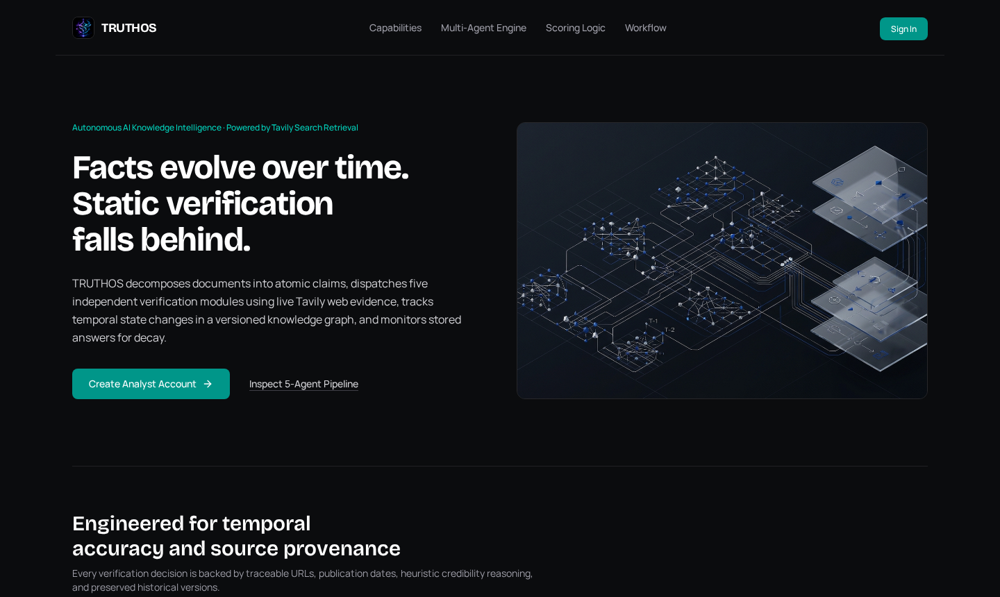 | 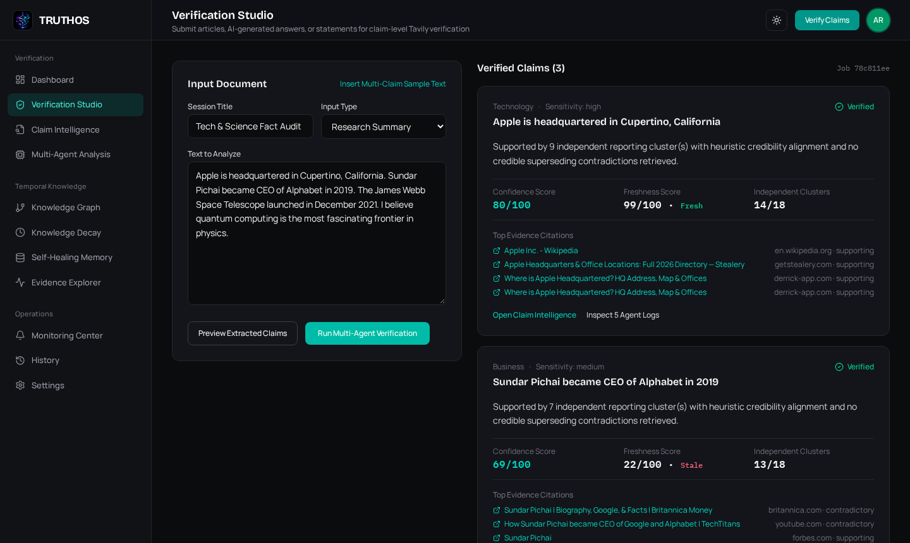 |

### Intelligence Overview & Claim Inspection

| 3. Intelligence Overview Dashboard | 4. Claim Intelligence & Scoring Breakdown |
| :--- | :--- |
| Database-derived KPI ledger, Knowledge Decay Distribution bar chart, Domain Confidence vs. Freshness area chart, and session activity. | Subject–Predicate–Object decomposition, 5-component Confidence rubric, Freshness & Decay Estimate, and persistent 24h monitoring. |
| 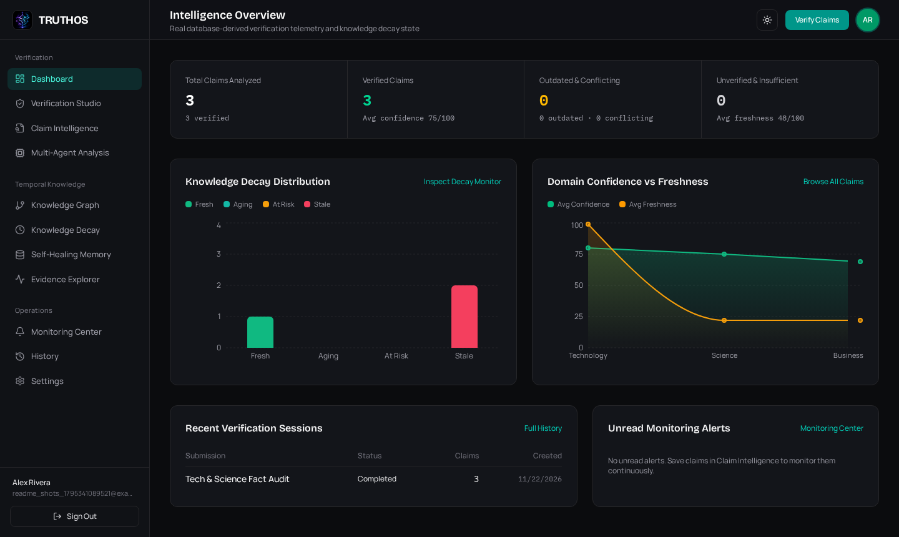 | 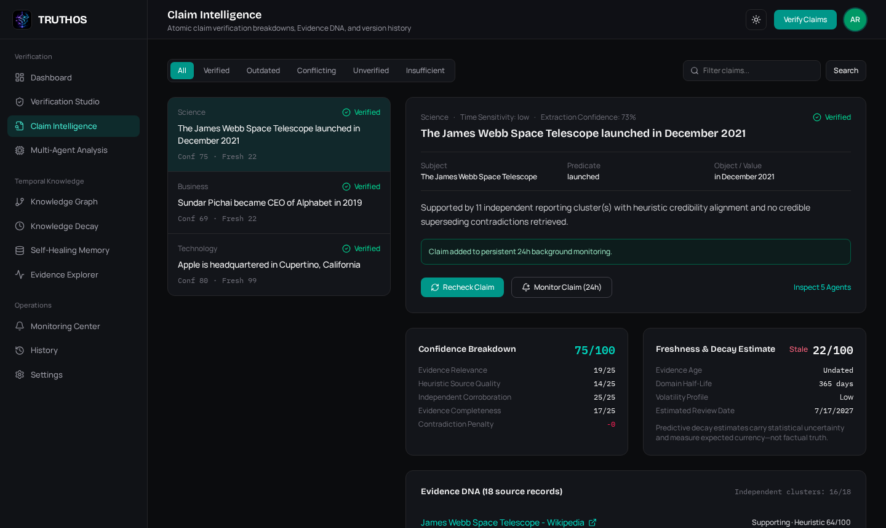 |

### Multi-Agent Execution & Temporal Knowledge Graph

| 5. 5-Module Multi-Agent Pipeline | 6. Temporal Knowledge Graph |
| :--- | :--- |
| Step-by-step execution traces across Researcher, Skeptic, Temporal Intelligence, Evidence Analyst, and Judge with query latencies. | Interactive React Flow entity cards, Flow / Orbit / Grid layouts, subgraph spotlighting, and Temporal Inspector validity timelines. |
| 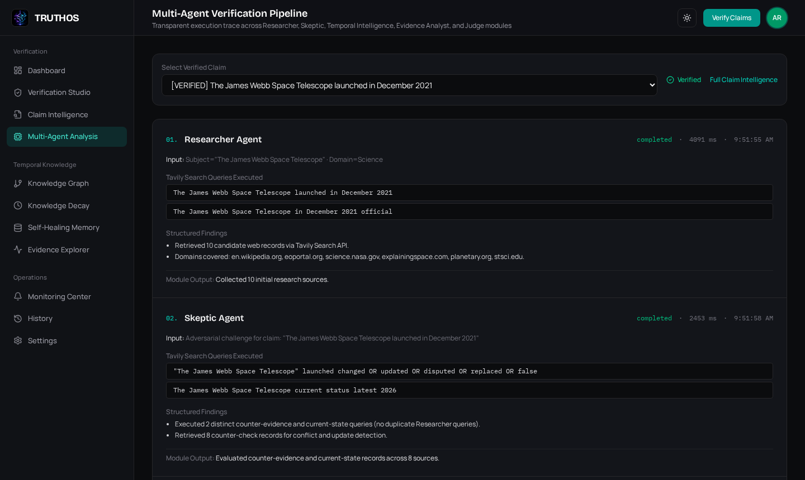 | 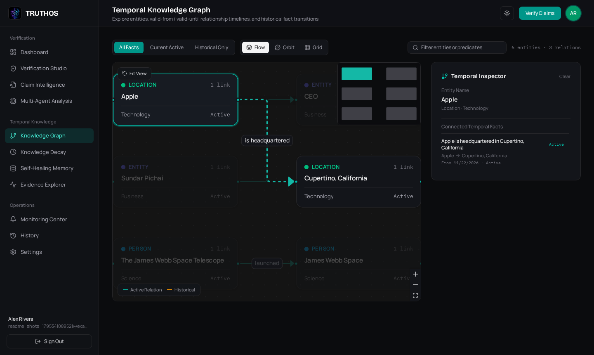 |

### Decay Monitoring & Self-Healing Memory

| 7. Predictive Knowledge Decay Monitor | 8. Self-Healing Knowledge Memory |
| :--- | :--- |
| Freshness Lifecycle Ring donut chart, Domain Freshness vs. 60/100 review threshold bar chart, and staleness-ordered review table. | Non-destructive fact versioning (`v1`, `v2`), Before-and-After Change Intelligence, and Knowledge Dependency impact mapping. |
| 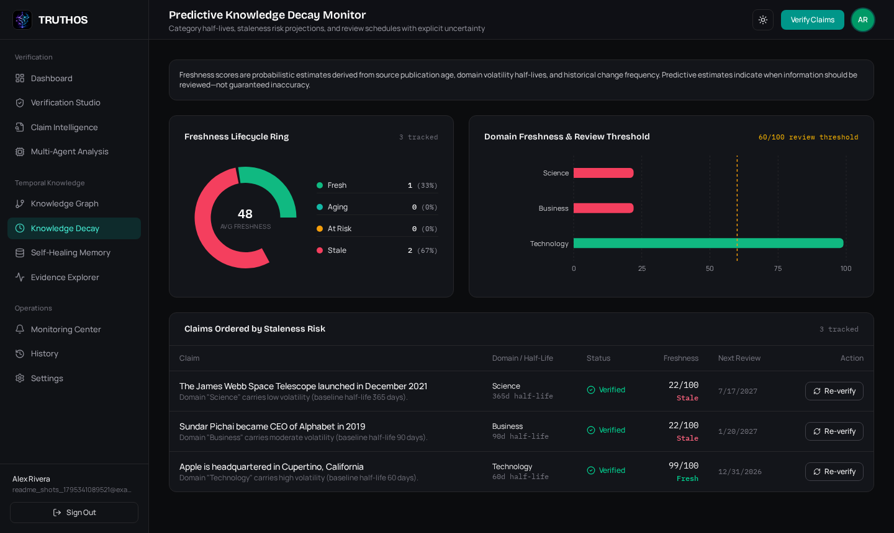 | 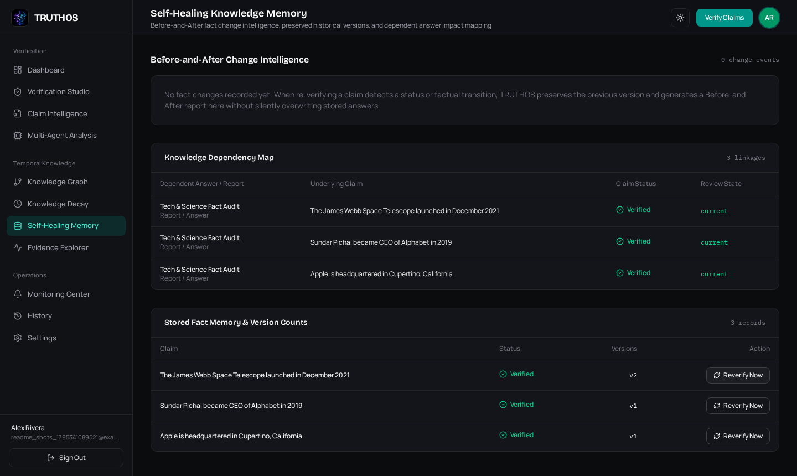 |

### Evidence Provenance & Autonomous Monitoring

| 9. Evidence DNA Explorer & Export | 10. Autonomous Monitoring Center |
| :--- | :--- |
| Direct backend Tavily research queries, stance/duplication filtering, cluster inspection, and structured JSON / CSV provenance exports. | Persistent scheduled claim re-verification with configurable frequency, freshness alert thresholds, manual triggers, and execution logs. |
| 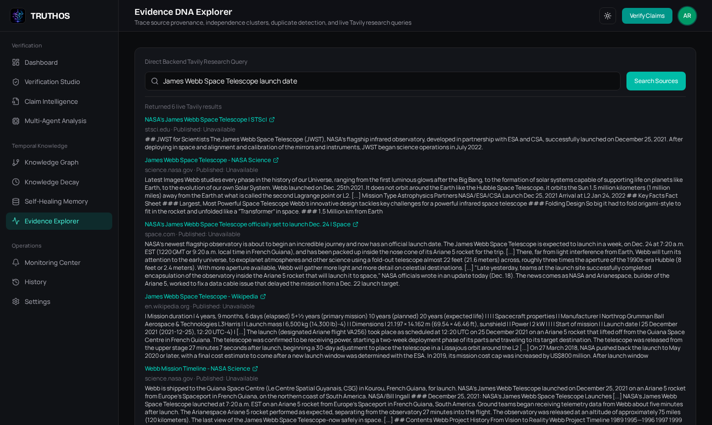 | 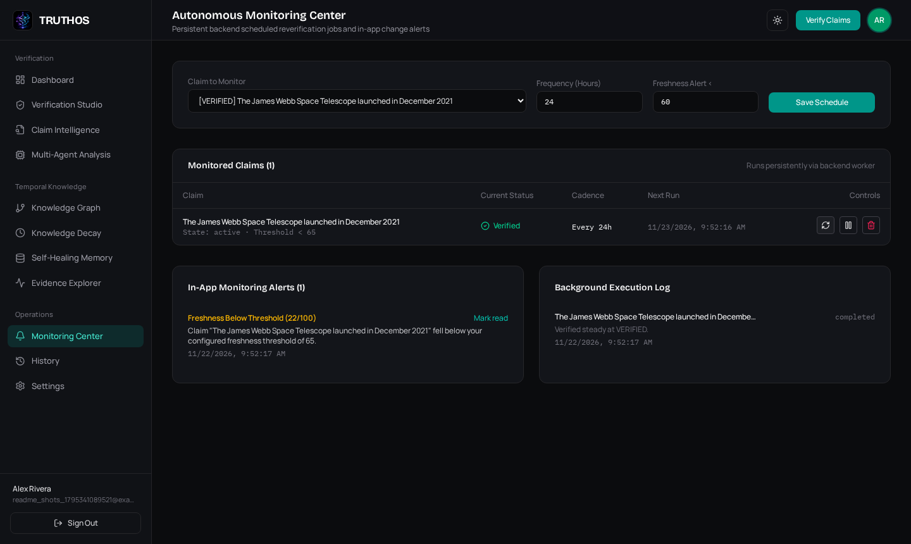 |

### Audit History & Workspace Controls

| 11. Audit & Verification History | 12. Settings, API Status & Dual Theme |
| :--- | :--- |
| Real-time searchable ledger of verification sessions, exact Tavily Search API query logs (HTTP status, cache hits, latency), and fact changes. | Alabaster Editorial light mode toggle, analyst threshold preferences, and backend Tavily API status verification with zero key exposure. |
| 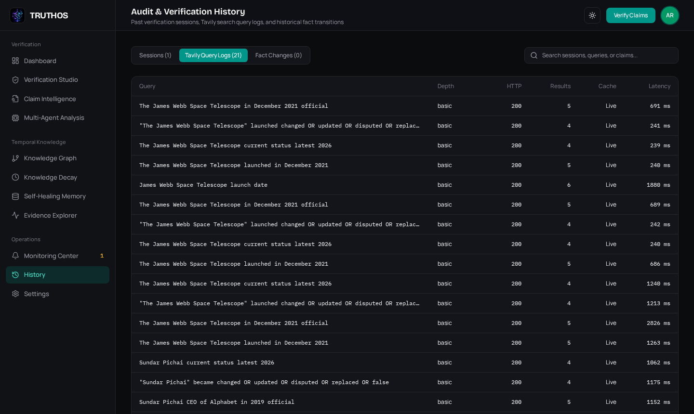 | 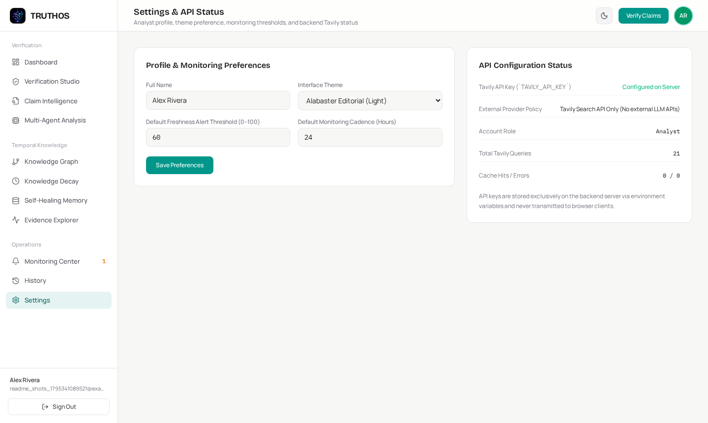 |

---

## ✨ Key Features

### 1. Deterministic NLP Claim Extraction (`server/engine/claimExtractor.ts`)
- Splits documents, news reports, and AI-generated outputs into candidate sentences using **`compromise`** NLP.
- Separates verifiable factual assertions into structured **Subject – Predicate – Object** triples while filtering out subjective opinions, questions, and speculative statements.
- Automatically classifies each claim into a knowledge domain (`Finance`, `Artificial Intelligence`, `Technology`, `Business`, `Politics & Government`, `Law & Regulation`, `Healthcare`, `Environment`, `Science`, `Education`, `General Knowledge`) and assigns a baseline half-life.

### 2. Five-Module Multi-Agent Verification Pipeline (`server/engine/agents.ts`)
Every extracted claim runs sequentially through five transparent verification modules:
1. **Researcher Agent** — Issues primary and official-source queries via the Tavily Search API (`basic` or `advanced` depth based on time sensitivity).
2. **Skeptic Agent** — Issues adversarial counter-queries (`changed OR updated OR disputed OR replaced OR false` and current-state queries) to surface contradictions or role/status changes.
3. **Temporal Intelligence Agent** — Compares evidence publication timestamps against domain volatility and checks for superseding newer records.
4. **Evidence Analyst Agent** — Applies canonical URL deduplication and 3-gram Jaccard text similarity (`server/engine/similarity.ts`) so syndicated copies collapse into one independence cluster.
5. **Judge Agent** — Synthesizes retrieved evidence into an explainable verdict (`VERIFIED`, `OUTDATED`, `CONFLICTING`, `UNVERIFIED`, or `INSUFFICIENT EVIDENCE`) with full reasoning.

### 3. Independent Confidence & Freshness Scoring (`server/engine/scoring.ts`)
- **Confidence Score (`0–100`)**: Combines Evidence Relevance (`0–25`), Heuristic Source Quality (`0–25`), Independent Corroboration (`0–25`), and Evidence Completeness (`0–25`), minus Contradiction Penalty (`0 to -35`).
- **Freshness & Predictive Decay Score (`0–100`)**: Uses exponential decay $100 \times 0.5^{\text{age} / \text{effective\_half\_life}}$, accelerating decay when historical fact changes are detected and categorizing claims into `Fresh` (`75–100`), `Aging` (`50–74`), `At Risk` (`25–49`), or `Stale` (`0–24`).

### 4. Evidence DNA & Structured Reporting (`src/pages/EvidenceExplorerPage.tsx`)
- Inspect source domain tiers, heuristic credibility explanations (`server/engine/credibility.ts`), publication dates, stance tags, and cluster IDs.
- Run on-demand direct backend Tavily searches.
- Export filtered or complete Evidence DNA records as **structured JSON** (with export metadata) or **UTF-8 CSV** for external audits and reporting.

### 5. Interactive Temporal Knowledge Graph (`src/pages/KnowledgeGraphPage.tsx`)
- Built with **`@xyflow/react`** featuring custom entity cards (`Organization`, `Person`, `Location`, `Date/Metric`), MiniMap, and zoom controls.
- Switch between **Flow**, **Orbit**, and **Grid** layouts, filter by **All Facts / Current Active / Historical Only**, search entities/predicates, and inspect `valid_from` / `valid_until` windows in the **Temporal Inspector**.

### 6. Self-Healing Memory & Autonomous Monitoring (`server/engine/memoryAndGraph.ts`, `server/workers/monitoringWorker.ts`)
- Preserves immutable version snapshots (`fact_versions`) and `Before-and-After` diffs (`historical_facts`) whenever re-verification detects a shift.
- Tracks dependent knowledge records (`knowledge_dependencies`) and flags impacted reports as `needs_review`.
- Runs a persistent background monitoring worker (`60s` polling interval) that executes due schedules, logs runs, and triggers in-app alerts on status change or threshold breach.

### 7. Security, Auditability & Dual Theme UX
- **Authentication & Isolation**: JWT access tokens + `HttpOnly` cookies, `bcryptjs` password hashing, and strict user-scoped database queries across all routes.
- **Hardening**: Sliding-window per-route rate limiting (`authLimiter`, `researchLimiter`), SSRF-safe external URL checks (`isSafeExternalUrl`), and untrusted retrieved-snippet sanitization (`sanitizeRetrievedText`).
- **Dual Theme Interface**: Instant switching between **Carbon Obsidian (Dark Default)** and **Alabaster Editorial (Light)** persisted to user preferences, plus a top-right account popover and live searchable History page.

---

## 🏗️ System Architecture

```text
┌────────────────────────────────────────────────────────────────────────────┐
│                        TRUTHOS React 19 + Vite SPA                         │
│  Dashboard · Verification Studio · Claim Intelligence · 5-Agent Traces     │
│  Temporal Graph (@xyflow/react) · Decay Monitor (Recharts) · Memory · DNA  │
└─────────────────────────────────────┬──────────────────────────────────────┘
                                      │ HTTPS / REST (/api/*) + JWT / Cookie
                                      ▼
┌────────────────────────────────────────────────────────────────────────────┐
│                   Node.js + Express Server (server.ts :3000)               │
│                                                                            │
│  ┌──────────────────────┐   ┌────────────────────────────────────────────┐ │
│  │ Auth & Security      │   │ Deterministic Verification Engine          │ │
│  │ · JWT + HttpOnly     │   │ · Claim Extractor (compromise NLP)         │ │
│  │ · Rate Limiters      │   │ · 5 Agents (Researcher → Judge)            │ │
│  │ · SSRF & Sanitizer   │   │ · 3-Gram Jaccard Similarity Clustering     │ │
│  └──────────────────────┘   │ · Credibility, Confidence & Decay Scoring  │ │
│                             └─────────────────────┬──────────────────────┘ │
│  ┌──────────────────────┐                         │                        │
│  │ Background Worker    │◄────────────────────────┤                        │
│  │ · monitoringWorker   │                         │                        │
│  │   (60s schedule poll)│                         ▼                        │
│  └──────────┬───────────┘   ┌────────────────────────────────────────────┐ │
│             │               │ SQLite (better-sqlite3 · WAL Mode)         │ │
│             └──────────────►│ 19 tables: claims, evidence, fact_versions │ │
│                             │ KG entities/edges, schedules, alerts, logs │ │
│                             └────────────────────────────────────────────┘ │
└─────────────────────────────────────┬──────────────────────────────────────┘
                                      │ Backend-Only HTTPS POST
                                      ▼
                    ┌───────────────────────────────────┐
                    │ Tavily Search API                 │
                    │ https://api.tavily.com/search     │
                    │ (Sole External Research Provider) │
                    └───────────────────────────────────┘

Optional Production Companion (docker-compose.yml):
  backend/ (FastAPI + SQLAlchemy + httpx) ──► PostgreSQL 16 + Redis 7 + Celery Beat
```

> **External Provider Verification:** Codebase inspection confirms **Tavily Search API** is the sole external research integration (`server/services/tavilyClient.ts` and `backend/app/tavily_client.py`). No external LLM APIs or Bifrost gateways are present in the codebase.

---

## 🛠️ Technology Stack

| Layer | Technologies Used |
|---|---|
| **Frontend** | React 19, TypeScript, Vite 8, Tailwind CSS v4 (`@tailwindcss/vite`), React Router v7, Recharts 3, React Flow (`@xyflow/react`), Lucide React, Motion |
| **Backend (Active Runtime)** | Node.js, Express 4, `tsx`, `better-sqlite3` (WAL mode), `bcryptjs`, `jsonwebtoken`, `compromise` (local NLP), `dotenv` |
| **External Research API** | Tavily Search API (`POST https://api.tavily.com/search`, SHA-256 query cache with 60-minute TTL, retry & rate-limit backoff) |
| **Testing & Tooling** | Vitest 5, TypeScript (`tsc --noEmit`) |
| **Enterprise Companion (`backend/`)** | Python FastAPI, Uvicorn, Pydantic v2, SQLAlchemy 2, PostgreSQL 16, Redis 7, Celery Beat, `httpx`, Docker & Docker Compose |

---

## ⚙️ How It Works

1. **Workspace Authentication**: Analysts sign up or sign in (`POST /api/auth/register` or `/api/auth/login`). Each workspace is isolated per user and begins clean.
2. **Document Submission & Local NLP Extraction**: In **Verification Studio**, users submit text (articles, research summaries, or AI answers). `extractClaimsFromText()` uses `compromise` to isolate factual claims, extract Subject–Predicate–Object triples, discard opinions/questions, and classify domain volatility.
3. **5-Agent Live Tavily Retrieval**: `runMultiAgentVerification()` dispatches the **Researcher** and **Skeptic** agents to query Tavily Search API via the backend (never exposing `TAVILY_API_KEY` to the browser), caching results in `tavily_search_cache` and auditing every call in `tavily_query_logs`.
4. **Deduplication & Heuristic Credibility**: Retrieved snippets are sanitized against prompt injection, URLs are validated and canonicalized, and 3-gram Jaccard similarity (`analyzeSourceDuplication`) groups copied articles into independence clusters alongside domain-tier credibility scoring.
5. **Independent Confidence & Decay Computation**: The **Judge Agent** computes `Confidence (0–100)`, `Freshness (0–100)`, decay state, and next review date, then persists results across relational tables (`extracted_claims`, `evidence_records`, `agent_executions`, `confidence_scores`, `freshness_scores`).
6. **Temporal Knowledge Graph & Versioned Memory**: Entities and predicates populate `entities` and `knowledge_graph_relationships` with `valid_from` / `valid_until` windows, while `fact_versions` and `historical_facts` maintain full version lineage.
7. **Continuous Monitoring & Export**: Users enroll claims into scheduled background re-checks via the **Monitoring Center**, receive in-app alerts on threshold breaches or factual drift, and export Evidence DNA as **JSON** or **CSV**.

---

## 🚀 Installation and Setup

### Prerequisites
- **Node.js** `>= 20` and **npm**
- A **Tavily API key** ([tavily.com](https://tavily.com/)) for live web evidence retrieval
- *(Optional)* **Docker & Docker Compose** if running the multi-container FastAPI + PostgreSQL + Celery companion stack

### 1. Clone and Install Dependencies

```bash
git clone <your-repository-url>
cd truthos
npm install
```

### 2. Configure Environment Variables

Copy `.env.example` to `.env` and populate your backend secrets:

```bash
cp .env.example .env
```

| Variable | Required | Default | Description |
|---|---|---|---|
| `TAVILY_API_KEY` | **Yes** (for live checks) | — | Backend-only Tavily Search API key (`tvly-...`). Never exposed to clients. |
| `SECRET_KEY` | **Yes** (in prod) | dev fallback | Strong random secret used to sign JWT access tokens. |
| `PORT` | No | `3000` | HTTP port for the Express API + Vite/SPA server. |
| `NODE_ENV` | No | `development` | `development` (Vite middleware) or `production` (serves `dist/`). |
| `DATABASE_PATH` | No | `./data/truthos.db` | Local SQLite database file path. |
| `ACCESS_TOKEN_EXPIRE_MINUTES` | No | `1440` | JWT session lifetime in minutes (default 24h). |
| `DATABASE_URL` | Optional (Docker/Py) | `postgresql+psycopg2://...` | PostgreSQL connection string for the Python FastAPI companion. |
| `REDIS_URL` | Optional (Docker/Py) | `redis://localhost:6379/0` | Redis broker URL for Celery Beat periodic tasks. |

### 3. Run Locally (Development)

Starts the Express backend API, persistent 60s monitoring worker, and Vite React frontend together on port `3000`:

```bash
npm run dev
```

Open **[http://localhost:3000](http://localhost:3000)** in your browser.

### 4. Verify Tests, Type-Check & Production Build

```bash
npm test       # Runs Vitest core engine & API integration tests (tests/truthos.test.ts)
npm run lint   # Runs TypeScript type-checking (tsc --noEmit)
npm run build  # Builds production frontend bundle into dist/
```

To run the production build locally:

```bash
NODE_ENV=production npm start
```

### 5. Optional: Multi-Service Docker Compose Stack

```bash
TAVILY_API_KEY=your_tavily_key SECRET_KEY=your_strong_secret docker compose up --build
```

This starts PostgreSQL (`5432`), Redis (`6379`), FastAPI (`8000`), Celery Beat worker, and the web app (`3000`).

---

## 📁 Project Folder Structure

```text
truthos/
├── server.ts                          # Express + Vite middleware entrypoint & 60s worker boot
├── server/
│   ├── core/security.ts               # Password hashing, JWT, auth middleware, SSRF & sanitization
│   ├── db/database.ts                 # SQLite (better-sqlite3 WAL) schema (19 tables) & indexes
│   ├── engine/
│   │   ├── claimExtractor.ts          # compromise NLP claim extraction & domain volatility policy
│   │   ├── agents.ts                  # 5-agent verification pipeline (Researcher → Judge)
│   │   ├── similarity.ts              # URL canonicalization & 3-gram Jaccard duplication clustering
│   │   ├── credibility.ts             # Heuristic source tier & domain credibility evaluator
│   │   ├── scoring.ts                 # Independent Confidence (0–100) & Freshness Decay models
│   │   ├── memoryAndGraph.ts          # Temporal Knowledge Graph & Self-Healing Fact Versioning
│   │   └── sampleWorkspace.ts         # Optional isolated development sample data loader
│   ├── routes/api.ts                  # REST API routes, OpenAPI spec & rate limiters
│   ├── services/
│   │   ├── tavilyClient.ts            # Sole external API client (Tavily + cache + backoff + logs)
│   │   ├── verificationService.ts     # End-to-end submission & recheck orchestration
│   │   └── claimQueryService.ts       # Hydrated claim intelligence queries
│   └── workers/monitoringWorker.ts    # Persistent background scheduler for due monitoring jobs
├── src/
│   ├── App.tsx                        # React Router v7 routes & ProtectedRoute guard
│   ├── components/
│   │   ├── AppShell.tsx               # Navigation rail, top header, theme toggle & account popover
│   │   └── StatusIndicator.tsx        # Verdict & Decay state indicators
│   ├── context/AuthContext.tsx        # Session hydration, login/register & theme state
│   ├── pages/
│   │   ├── LandingPage.tsx            # Public landing & architecture overview
│   │   ├── AuthPage.tsx               # Sign-in / registration page
│   │   ├── DashboardPage.tsx          # Intelligence Overview KPIs & Recharts visualizations
│   │   ├── VerificationStudioPage.tsx # Document input, NLP preview & live Tavily verification
│   │   ├── ClaimIntelligencePage.tsx  # Atomic claim scores, Evidence DNA & timeline
│   │   ├── MultiAgentAnalysisPage.tsx # 5-agent trace inspector
│   │   ├── KnowledgeGraphPage.tsx     # @xyflow/react Temporal Knowledge Graph (Flow/Orbit/Grid)
│   │   ├── DecayMonitorPage.tsx       # Freshness Lifecycle Ring & 60/100 domain threshold chart
│   │   ├── SelfHealingMemoryPage.tsx  # Version counts, Change Intelligence & Dependency Map
│   │   ├── EvidenceExplorerPage.tsx   # Direct Tavily search, filters & JSON/CSV export
│   │   ├── MonitoringCenterPage.tsx   # Schedule manager, manual re-runs & alerts
│   │   ├── HistoryPage.tsx            # Searchable Sessions, Tavily Query Logs & Fact Changes
│   │   └── SettingsPage.tsx           # Analyst preferences & backend Tavily API status
│   ├── services/api.ts                # Frontend fetch wrapper & token storage
│   └── types/truthos.ts               # Shared TypeScript interfaces
├── backend/                           # Python FastAPI + SQLAlchemy + Celery companion backend
│   ├── app/
│   │   ├── main.py                    # FastAPI app & /api/research/search endpoint
│   │   ├── models.py                  # SQLAlchemy ORM schema
│   │   ├── tavily_client.py           # Async httpx Tavily Search client
│   │   └── workers.py                 # Celery Beat periodic re-verification task
│   └── requirements.txt
├── docker/                            # Backend & frontend Dockerfiles
├── docker-compose.yml                 # Multi-service orchestration (Postgres, Redis, FastAPI, App)
├── docs/
│   ├── SCORING_AND_ARCHITECTURE.md    # Detailed mathematical scoring specification
│   └── screenshots/                   # Real application screenshots used in README
├── tests/truthos.test.ts              # Automated Vitest engine & API integration test suite
├── .env.example                       # Environment template
├── package.json
└── vite.config.ts
```

---

## 🔮 Future Improvements

- **Batch Document & URL Ingestion**: Direct PDF, Markdown, and web-URL extraction queues into Verification Studio.
- **Webhook & External Alert Channels**: Outbound Slack, email, and webhook notifications alongside in-app monitoring alerts when claims flip to `OUTDATED` or `CONFLICTING`.
- **Automated Database Migrations**: Alembic migration scripts synchronized with `backend/app/models.py` for zero-downtime PostgreSQL upgrades.
- **Team Workspaces & Shared Graph Views**: Multi-analyst organization workspaces with role-based permissions and shared verification ledgers.

---

## 🤝 Contributors & Acknowledgements

- **Built by:** TRUTHOS Engineering & Contributors
- **External Research Retrieval:** [Tavily Search API](https://tavily.com/) — sole external web evidence retrieval provider
- **Open-Source Foundations:** [React](https://react.dev/), [Express](https://expressjs.com/), [better-sqlite3](https://github.com/WiseLibs/better-sqlite3), [compromise](https://compromise.cool/), [React Flow (`@xyflow/react`)](https://reactflow.dev/), [Recharts](https://recharts.org/), [Tailwind CSS](https://tailwindcss.com/), and [Lucide Icons](https://lucide.dev/)
